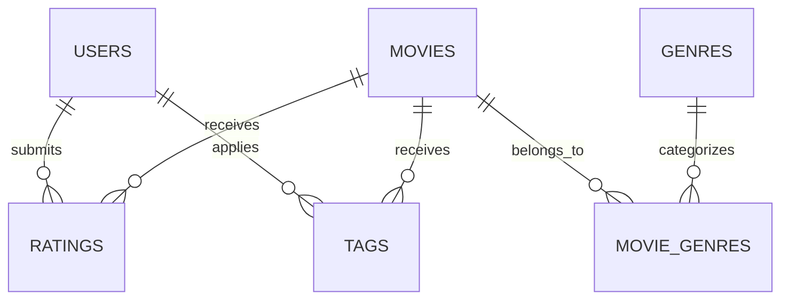

# MovieLens Analytics

A local DSCI 551 demo built around the supplied MovieLens archive. Streamlit runs its searches, rankings, genre summaries, and rating activity queries directly against MySQL.

## Run on Windows

If this folder already has a `.venv`, double-click `Start-Demo.cmd` or run it in a terminal. For a fresh setup, use Python 3.12 and MySQL Community Server 8.4 or newer.

```powershell
python -m venv .venv
.\.venv\Scripts\python.exe -m pip install -r requirements.txt
.\Start-Demo.cmd
```

Open [MovieLens Analytics](http://127.0.0.1:8501). The launcher creates a private MySQL data directory under `.demo`, starts MySQL on loopback port 33312, and imports the ZIP the first time. Press Ctrl+C in the launcher terminal to stop. On the next launch, it reuses the imported snapshot. The launcher creates app-specific credentials in the ignored `.demo` folder.

Pass `-MysqlServer` with the full path to `mysqld.exe` if automatic discovery misses your installation. Pass `-DatabasePort` or `-WebPort` if a default port is occupied. Pass `-Python` to use a different interpreter that already has the dependencies installed.

## Use another MySQL instance

Create a dedicated empty MySQL schema and an account with `SELECT`, `CREATE`, `INSERT`, and `REFERENCES` privileges on it. Set `MOVIELENS_DB_HOST`, `MOVIELENS_DB_PORT`, `MOVIELENS_DB_USER`, `MOVIELENS_DB_NAME`, and `MOVIELENS_DB_PASSWORD` in your terminal as needed. The defaults are `127.0.0.1`, `3306`, `movielens`, `movielens_demo`, and an empty password. Then run the importer and app from this folder.

```powershell
.\.venv\Scripts\python.exe -m movielens.load
.\.venv\Scripts\python.exe -m streamlit run app.py
```

The importer creates the tables, inserts the snapshot in one transaction, and refuses to overwrite existing rows. An alternate archive path can be passed to `movielens.load`. This demo’s preset benchmark dates and expected counts are based on the supplied ZIP.

## Walk through the demo

1. **Explore.** Search for **Toy Story** and filter by **Animation**. Show the genres and user tags attached to each movie.
2. **Rankings.** Start with 20 minimum ratings. Switch to **By genre and year** for 1990s Drama and run the join plan to see how MySQL looks up movies and ratings. Open **Genre comparison** for counts and averages. A rating appears in each genre assigned to its movie.
3. **Rating activity.** The default window of January 1–7, 2017 has 13 ratings, ordered by UTC timestamp. Switch to **Most active users** to see rating counts and average scores by anonymized user ID.
4. **Index lab.** Run the **7 days** window, compare the two plans, then run the **18 years** window. Point out the access method, the sort step, actual rows, and whether the index changes the plan. The wider window matches 83,516 ratings and may favor a different access path.

The experiment makes `idx_ratings_rated_at` eligible only in the comparison session. The invisible index remains physically present while the baseline optimizer ignores it. Both modes fetch the same ordered rows and use the same SQL. The timing is the median of five warmed client-side runs per mode, including result transfer and decoding. `EXPLAIN ANALYZE` provides MySQL’s server-side plan and timings. [MySQL invisible indexes](https://dev.mysql.com/doc/refman/8.4/en/invisible-indexes.html) · [MySQL EXPLAIN](https://dev.mysql.com/doc/refman/8.4/en/explain.html)

### Observed execution plans

These are examples from the supplied snapshot on MySQL 26.7. Use the live plans for the exact numbers during your demo.

| Workload | What MySQL did |
| --- | --- |
| 1990s Drama, at least 20 ratings | Scanned 9,742 movies, used the `movie_genres` composite primary key to test genre membership, then looked up ratings by movie with `idx_ratings_movie`. The nested-loop join produced 15,879 rows against an estimate of 12,172. MySQL aggregated those rows, applied the rating-count cutoff, and sorted 197 eligible titles for the top 25. |
| Seven days in January 2017 | The baseline scanned 100,836 ratings and sorted the 13 matches. The timestamp index read the 13-row range in order, with no separate sort. |
| 2000–2017 | Both plans scanned the ratings table and sorted 83,516 matches. The window covered 82.8% of the table, making the full scan the optimizer’s choice even with the timestamp index eligible. |

## Database model



See [schema.sql](schema.sql) for the table definitions, foreign keys, and indexes. The loader normalizes genre memberships into 22,050 movie–genre rows, derives users from ratings and tags, preserves unknown release years as NULL, and writes times as UTC `DATETIME`. It refreshes MySQL’s optimizer statistics after the bulk load so those statistics persist across restarts. The optional external movie identifiers in `links.csv` are outside the six-table design.

## Verify

```powershell
.\Start-Demo.cmd -Verify
```

This checks archive normalization, the six query types, the MySQL index comparison, and the Streamlit views. The archive check can also be run without MySQL with `python -m unittest discover -s tests -v`.

Dataset by GroupLens. [MovieLens latest-small release](https://grouplens.org/datasets/movielens/latest/) · [Dataset citation](https://doi.org/10.1145/2827872)
